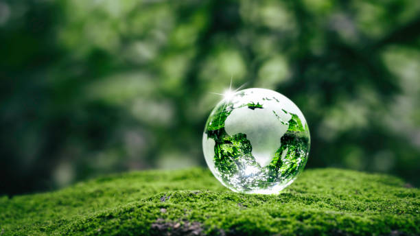

----------------------------------
[volver al Indice general](/readme.md)

"La sostenibilidad es un conceptoque busca satisfacer las necesidades del presente sin 
comprometer la capacidad de las generaciones futuras para satisfacer las suyas."

-----------------------------------
